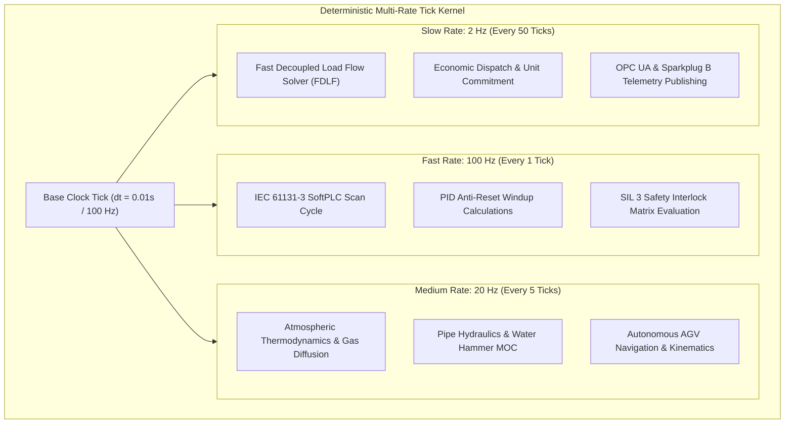
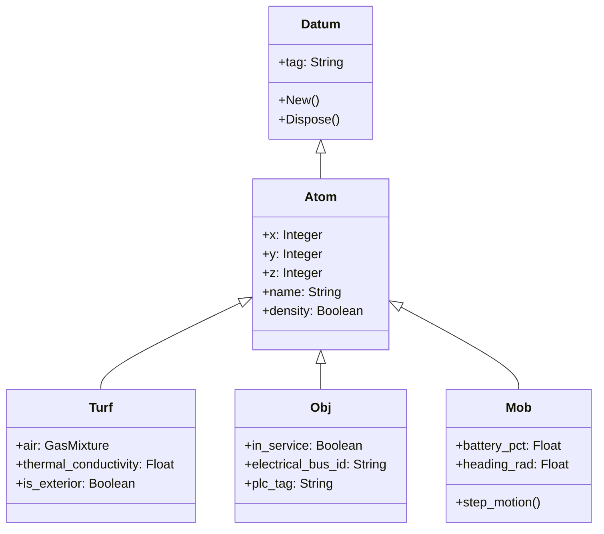
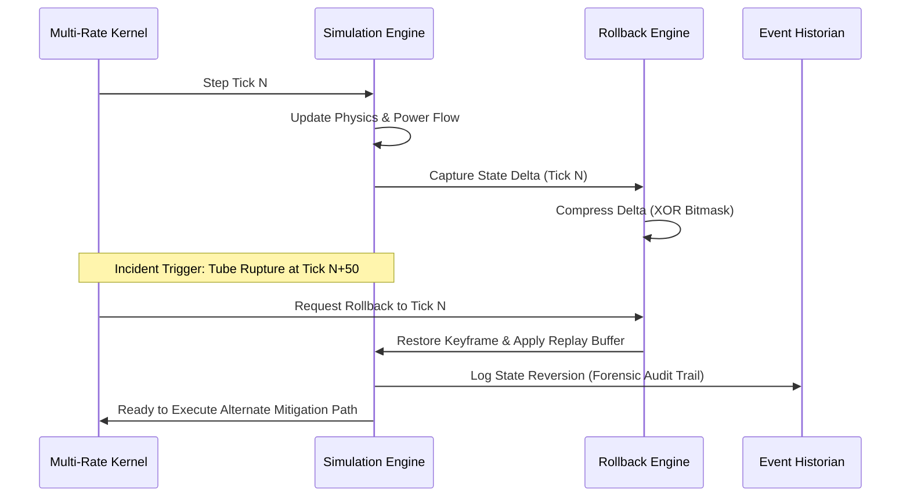

# Plenum Architecture & Technical Specification

## 1. Executive Summary

Plenum is an industrial-scale cyber-physical digital twin engine. It implements a deterministic multi-rate discrete-event simulation kernel designed to execute complex continuous-time physics, fluid dynamics, and electrical power flow alongside discrete-time industrial automation (IEC 61131-3 PLC) and autonomous robotics.

The core codebase is authored in **Dream Maker (DM)**, utilizing an object-oriented spatial datum hierarchy, while providing a pure standard-library Rust execution kernel for high-throughput headless execution, unit testing, and real-time visualization.

---

## 2. Multi-Rate Deterministic Scheduling

Industrial processes operate across vastly divergent physical time scales:
- Electrical power dynamics (sub-cycle faults, traveling waves) occur on millisecond scales.
- PLC control loops and digital interlocks scan periodically at 10 ms to 100 ms intervals.
- Acoustic pressure waves (water hammer) travel at 1,000 to 1,400 m/s, requiring small spatial time steps.
- Thermal diffusion and mass transfer in large vessels exhibit time constants ranging from tens of seconds to several hours.

To model these phenomena accurately without excessive computational burden, Plenum utilizes a **multi-rate hierarchical scheduler**:

Every state update is synchronized to an exact integer tick counter (`tick_count: u64`), eliminating non-deterministic floating-point timing jitter.

---

## 3. Spatial Datum Substrate & Memory Layout

Plenum builds upon the classic Dream Maker spatial object model, refining it for cyber-physical simulations:

1. **Datums (`/datum`)**: Pure mathematical and logical entities without direct spatial coordinates (e.g., PID controllers, gas mixture states, transfer functions, matrix solvers). Datums occupy minimal heap memory and support reference counting.
2. **Atoms (`/atom`)**: Physical entities possessing location (`x`, `y`, `z`), visibility, and material properties.
3. **Turfs (`/turf`)**: Fixed discrete cells forming the 2D/3D plant spatial grid. Each turf owns an atmospheric `/datum/physics/gas_mixture`, maintaining exact local partial pressures, temperature, and chemical composition.
4. **Objects (`/obj`)**: Discrete industrial machinery anchored to turfs (e.g., pumps, heat exchangers, valves, circuit breakers, transformers).
5. **Mobs (`/mob`)**: Mobile physical entities (e.g., plant operators, automated guided vehicles AGVs, aerial inspection drones).

---

## 4. Deterministic Rollback Replay Engine

For cyber-physical security research, fault injection analysis, and incident root-cause forensics, Plenum incorporates a **delta-compressed state snapshot rollback engine**:

1. **Keyframe Capture**: At fixed intervals (e.g., every 100 ticks = 5 seconds), a full keyframe snapshot of the global state vector is recorded.
2. **Delta Compression**: For intermediate ticks, only the mutated state variables are captured as an XOR difference bitmask relative to the preceding frame.
3. **Time-Travel Rewind**: The simulation kernel can rewind execution to any arbitrary historical tick in $O(1)$ lookup time, replaying alternative operator actions or fault mitigation sequences.

---

## 5. Subsystem Coupling & Conservation Interfaces

The primary challenge in cyber-physical digital twins is ensuring strict energy and mass conservation across subsystem boundaries:

1. **Fluid-to-Thermal Coupling**: The enthalpy flux exiting a boiler steam drum ($h \cdot \dot{m}$) is matched precisely to the energy ingress entering the steam turbine governor valves.
2. **Thermal-to-Electrical Coupling**: Shaft mechanical power output produced by the turbine expander ($P_{\mathrm{mech}} = \dot{m} \cdot \Delta h \cdot \eta$) drives the active power generation ($P_{\mathrm{gen}}$) assigned to the microgrid generator bus.
3. **Electrical-to-Hydraulic Coupling**: Electric motors driving high-pressure feedwater pumps draw electrical real power ($P_{\mathrm{elec}} = \frac{Q \cdot \Delta P}{\eta_{\mathrm{pump}} \cdot \eta_{\mathrm{motor}}}$) from the motor control center (MCC) bus, directly loading the power flow grid.
4. **SCADA-to-Physical Coupling**: PLC analog outputs modulate pneumatic control valve actuators via non-linear flow coefficient ($C_v$) curves, modifying physical hydraulic resistance without discontinuous numeric shocks.
