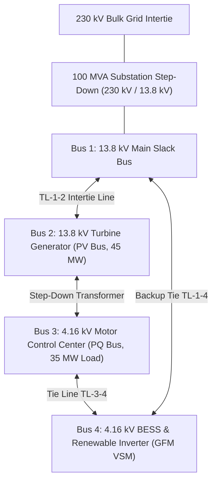

# Electrical Microgrid, Power Flow & Protective Relaying

## 1. Electrical Network Architecture

Plenum models industrial facility microgrids operating at 13.8 kV distribution and 4.16 kV motor feeds with utility grid interties, on-site synchronous generation (gas and steam turbines), renewable solar PV, and battery energy storage systems (BESS).

---

## 2. Fast Decoupled Load Flow (FDLF)

The electrical network solves the non-linear algebraic power balance equations across all $N$ buses:

$$S_i = P_i + j Q_i = V_i I_i^* = V_i \sum_{k=1}^{N} Y_{ik}^* V_k^*$$

Plenum uses the **Fast Decoupled Load Flow (FDLF)** formulation, partitioning the Jacobian matrix into decoupled $B'$ and $B''$ sub-matrices:

$$\Delta P / V = B' \cdot \Delta \theta$$

$$\Delta Q / V = B'' \cdot \Delta V$$

### Iterative Algorithm:
1. Initialize voltage magnitudes $V_i = 1.0 \text{ pu}$ and angles $\theta_i = 0.0 \text{ rad}$ for all non-slack buses.
2. Evaluate active power mismatches $\Delta P_i = P_{i,\mathrm{scheduled}} - P_{i,\mathrm{calculated}}$.
3. Solve for angle corrections: $\Delta \theta = [B']^{-1} \cdot (\Delta P / V)$.
4. Update bus angles: $\theta^{(k+1)} = \theta^{(k)} + \Delta \theta$.
5. Evaluate reactive power mismatches $\Delta Q_i = Q_{i,\mathrm{scheduled}} - Q_{i,\mathrm{calculated}}$.
6. Solve for voltage corrections: $\Delta V = [B'']^{-1} \cdot (\Delta Q / V)$.
7. Update bus voltage magnitudes: $V^{(k+1)} = V^{(k)} + \Delta V$.
8. Repeat until maximum mismatch falls below convergence tolerance ($\varepsilon < 10^{-4} \text{ pu}$).

---

## 3. Protective Relaying Coordination

Plenum incorporates numerical models of standard protective relay elements:

### 3.1 IEC 60255 IDMT Overcurrent (51)
Operating time $t$ for inverse time relays is evaluated per IEC 60255:

$$t(I) = \mathrm{TMS} \cdot \left[ \frac{\alpha}{\left(\frac{I}{I_{\mathrm{pickup}}}\right)^\beta - 1} \right]$$

| Curve Standard | $\alpha$ | $\beta$ | Typical Application |
| :--- | :--- | :--- | :--- |
| **IEC Standard Inverse** | 0.14 | 0.02 | General feeder distribution |
| **IEC Very Inverse** | 13.5 | 1.00 | Cables subject to high through-fault currents |
| **IEC Extremely Inverse** | 80.0 | 2.00 | Transformer inrush & grading with power fuses |
| **IEEE Moderately Inverse** | 0.0515 | 0.02 | Utility intertie breakers |

### 3.2 Mho Distance Protection (21)
Three-zone distance relays monitor the apparent positive-sequence impedance $Z_{\mathrm{apparent}} = \frac{V_{\mathrm{secondary}}}{I_{\mathrm{secondary}}}$:
- **Zone 1**: Protects 80% to 85% of line length with instantaneous trip ($0 \text{ ms}$).
- **Zone 2**: Reaches 120% of line length with intentional time delay ($300 \text{ ms}$) to coordinate with downstream breakers.
- **Zone 3**: Remote backup reaching 150% of adjacent line ($600 \text{ ms}$).

### 3.3 Transformer Percentage Differential (87T)
Protects against internal winding short-circuits while remaining stable during external through-faults and magnetizing inrush:

$$I_{\mathrm{diff}} = |I_{\mathrm{primary}} - I_{\mathrm{secondary}}|$$

$$I_{\mathrm{restraint}} = \frac{|I_{\mathrm{primary}}| + |I_{\mathrm{secondary}}|}{2}$$

Tripping is asserted only when $I_{\mathrm{diff}} > \mathrm{Slope} \cdot I_{\mathrm{restraint}}$ and the 2nd harmonic current ratio $\frac{I_{2\mathrm{nd}}}{I_{1\mathrm{st}}} < 15\%$, avoiding false trips during transformer energization inrush.

---

## 4. Grid-Forming (GFM) Inverters & Virtual Synchronous Machines

As renewable penetration increases, conventional rotational physical inertia decreases. Plenum models Battery Energy Storage Systems (BESS) running **Grid-Forming Virtual Synchronous Machine (VSM)** controls.

The inverter emulates rotor kinetic energy via the swing equation:

$$2H \cdot \frac{d\omega_{\mathrm{pu}}}{dt} = P_{\mathrm{order}} - P_e - D_p \cdot (\omega_{\mathrm{pu}} - \omega_{\mathrm{grid}})$$

Voltage droop regulation maintains grid voltage stability:

$$E_{\mathrm{internal}} = V_{\mathrm{nominal}} - D_q \cdot (Q_e - Q_{\mathrm{order}})$$

This provides autonomous black-start capability, instantaneous frequency support during generator trips, and RoCoF damping.
