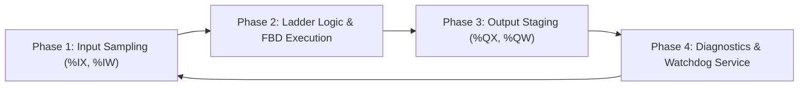
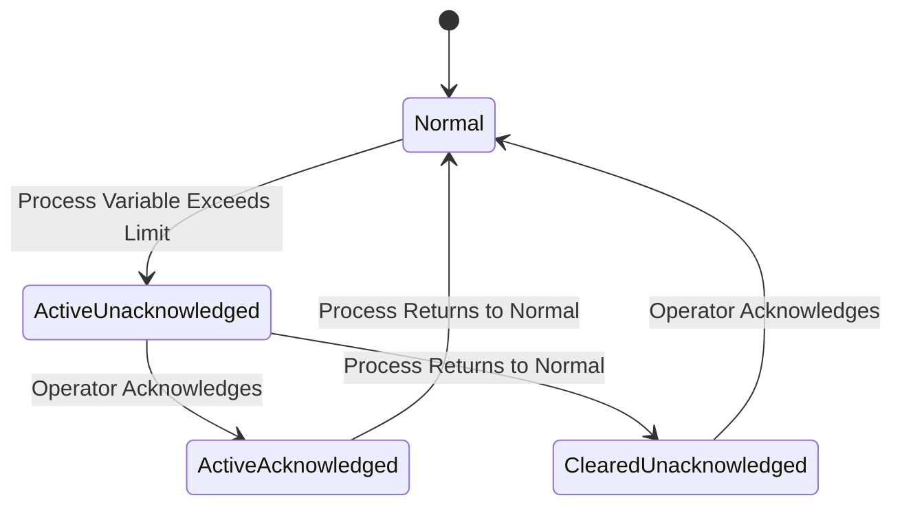

# IEC 61131-3 Industrial Automation & ISA-18.2 Alarm Specification

## 1. Overview

Plenum implements a fully compliant, deterministic software execution engine for IEC 61131-3 Programmable Logic Controllers (SoftPLC). It executes industrial control algorithms, interlocks, continuous PID regulation, and safety shutdown matrices with fixed-scan timing guarantees.

---

## 2. Cyclic Scan Architecture

The SoftPLC runtime executes in a deterministic four-phase cyclic sequence:



1. **Input Sampling**: Physical turf instrumentation, pressure transmitters (4-20mA), and digital level switches are sampled into the input image register `%I`.
2. **Logic Execution**: Ladder rungs and function blocks execute sequentially without side effects on physical hardware. Memory flags `%M` maintain internal state.
3. **Output Staging**: Updated control commands, solenoid valve actuations, and pump start/stop contacts are transferred to output image register `%Q`.
4. **Diagnostics**: Watchdog timers assert scan-time integrity (< 10 ms execution budget).

---

## 3. Ladder Diagram (LD) Semantics

Plenum formulates ladder rungs as directed Boolean logic equations:

```text
 |   %IX0.0 (High Level)    %IX0.1 (Permissive)          %QX0.0 (Feed Pump)  |
 |----------[ / ]-------------------[   ]-----------------------(   )--------|
 |                                                                           |
 |   %QX0.0 (Pump Run)                                                       |
 |----------[   ]-------------------|                                        |
```

- **Normally Open Contact `[ ]`**: Passes energy when evaluated operand is True.
- **Normally Closed Contact `[/]`**: Passes energy when evaluated operand is False (fail-safe permissive).
- **Output Coil `( )`**: Sets target bit in `%Q` when input rung is energized.
- **Latch `(S)` and Unlatch `(R)` Coils**: Set/Reset latched memory flags requiring explicit clearing logic.

---

## 4. Advanced PID Control with Anti-Reset Windup

The continuous process control loop implements an ideal ISA parallel PID algorithm with **derivative action applied to the Process Variable (PV)** rather than the tracking error ($e = \mathrm{SP} - \mathrm{PV}$). This avoids severe actuator output spikes (derivative kick) upon instantaneous setpoint steps.

### Mathematical Formulation
The continuous-time control output $u(t)$ is:

$$u(t) = K_p \left[ e(t) + \frac{1}{T_i} \int_0^t e(\tau) d\tau - T_d \frac{d\mathrm{PV}}{dt} \right]$$

### Anti-Reset Windup Clamping
When an actuator reaches its physical limits ($u(t) \ge u_{\max}$ or $u(t) \le u_{\min}$), the integral accumulator is frozen if the error continues driving the output further into saturation:

$$\text{if } u_{\mathrm{unclamped}} \ge u_{\max} \text{ and } e(t) > 0: \quad \frac{dI}{dt} = 0$$

$$\text{if } u_{\mathrm{unclamped}} \le u_{\min} \text{ and } e(t) < 0: \quad \frac{dI}{dt} = 0$$

This prevents catastrophic integral overshoot and eliminates process cycling.

---

## 5. ISA-18.2 Alarm Management Lifecycle

Plenum models the complete alarm state transition lifecycle per ANSI/ISA-18.2 (Management of Alarm Systems for the Process Industries):



### Alarm States:
1. **Normal**: Process variable within safe operational deadbands.
2. **Active Unacknowledged (UNACK)**: High-priority annunciator flashing; requires operator confirmation.
3. **Active Acknowledged (ACK)**: Alarm condition recognized; silence audible horns while abnormal state persists.
4. **Cleared Unacknowledged (CLR_UA)**: Process transient returned to safe envelope before operator acknowledgement; requires audit sign-off.
